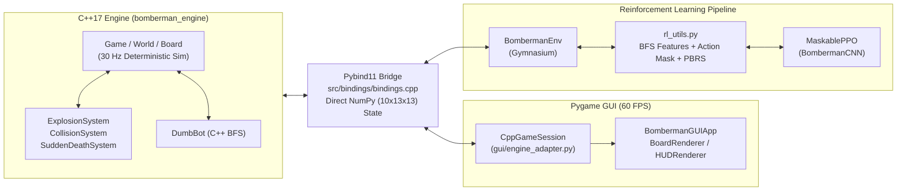
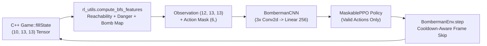

# Playing With Fire 2 — C++17 Game Engine & Reinforcement Learning Arena


-blue?style=flat-square)


A high-performance Bomberman-style tactical arena combining a deterministic **C++17 simulation engine**, **Pybind11** Python bindings, a decoupled **60 FPS Pygame GUI**, and a **Reinforcement Learning (`MaskablePPO`)** training and evaluation pipeline.

---

## Overview

**Playing With Fire 2** separates simulation performance from high-level rendering and machine learning workflows:

- **Simulation Core (C++17):** Handles grid physics, bomb chain reactions, sliding bomb mechanics, power-ups, Sudden Death perimeter shrinkage, and heuristic `DumbBot` AI at a fixed `30 Hz` tick rate.
- **Cross-Language Bridge (Pybind11):** Exposes the C++ `Game` engine to Python as `bomberman_engine`, writing spatial state tensors directly into NumPy arrays to avoid per-step Python object serialization during RL rollouts.
- **Interactive GUI & Spectator Modes (Pygame):** Renders at `60 FPS` with sub-tick coordinate interpolation, supporting local 1–2 player keyboard play, `DumbBot` matches, trained PPO opponents, live BFS debug heatmaps, and `1v1` AI Duel mode.
- **Reinforcement Learning Stack (Gymnasium + `sb3-contrib`):** Combines a custom `BombermanCNN` policy with Breadth-First Search (BFS) tactical feature channels, invalid-action masking, Potential-Based Reward Shaping (PBRS), curriculum randomization, and self-play.

---

## Key Features

### C++17 Game Engine
- **Deterministic `30 Hz` Simulation:** Fixed-timestep loop (`Game::update` / `Game::step`) independent of rendering frame rate.
- **Rich Bomberman Mechanics:**
  - **Chain-Reaction Detonations:** Bombs in line-of-fire trigger cascading explosions with propagated fuse timing.
  - **Hammer & Ring Abilities:** Hammer lets players kick bombs across corridors (sliding bombs pass cleanly through existing flames and retain the original planter's color while attributing RL kill credit to the pusher); Ring lets players walk across stationary bombs.
  - **5 Power-Ups:** Lightning (blast radius), Speed (movement cooldown reduction from 6 to 4 ticks), Extra Bomb, Hammer, and Ring, with a configurable drop rate (default `30%` on breakable walls).
  - **Gradual Sudden Death:** Shrinking perimeter deals `1 HP` on initial contact and `1 HP` every 5 seconds (`150` ticks) while trapped, allowing caught players to maneuver and escape back onto safe tiles.
- **Heuristic `DumbBot` Opponents:** BFS-based pathfinding, bomb-escape search, offensive Hammer kicking, and configurable imperfect Sudden Death caution.
- **Dual Targets:** Compiles to both a Python extension (`bomberman_engine*.so`) and a standalone terminal executable (`./bomberman`).

### Pygame 60 FPS GUI & AI Duel Mode
- **Strict Adapter Boundary:** Only `gui/engine_adapter.py` imports `bomberman_engine`; all rendering and controllers operate on immutable `GameSnapshot` objects (`IGameSession`), allowing headless testing with a pure-Python `MockGameSession`.
- **Smooth Sub-Tick Interpolation:** Accumulator loop steps the C++ engine at `30 Hz` while interpolating entity positions at `60 FPS` (`alpha` blending) with frame-spike protection.
- **Pre-Game Configuration Wizard:** Configure 1–2 human players, `DumbBot` count, trained PPO AI opponents, and 3 arena presets (*Classic Arena*, *Open Battleground*, *Dense Labyrinth*).
- **AI Debug Overlay (`H` / `F2`) & Duel Mode (`--duel`):** Visualizes the agent's live BFS `reach_map` and `bomb_map` overlays and supports spectating `MaskablePPO` vs. `PPO` models in GUI, CLI ASCII, or statistical tournament mode (`duel.py`).

---

## System Architecture



---

## AI & Reinforcement Learning

### Observation Space (`12 x 13 x 13` `float32`)
The agent observes a `12`-channel spatial grid built from `10` C++ engine channels and `2` Python BFS tactical channels:

| Channels | Source | Representation |
| :--- | :--- | :--- |
| `0 – 1` | C++ Engine | Static geometry: Solid walls (`0`) and Breakable walls (`1`) |
| `2` | C++ Engine | Active bombs weighted by remaining fuse urgency |
| `3` | C++ Engine | Composite danger map: live flames, blast lines, chain-reaction timers, sliding bomb trajectories, and imminent Sudden Death spiral urgency |
| `4` | C++ Engine | Active flames (`4`) |
| `5` | C++ Engine | Power-ups on the board (`5`) |
| `6 – 7` | C++ Engine | Self position & cooldown readiness (`6`) and Enemy positions (`7`) |
| `8 – 9` | C++ Engine | Broadcast player state: available bomb quota (`8`) and Hammer/Ring inventory flags (`9`) |
| `10 – 11` | `rl_utils.py` | BFS **Reachability Map** (`10`: normalized safe travel distance) and **Tactical Bomb Target Map** (`11`: safe-escape bombing sites) |



### Action Space & Masking
- **Action Space:** `Discrete(6)` — `0: NONE`, `1: UP`, `2: DOWN`, `3: LEFT`, `4: RIGHT`, `5: PLACE_BOMB`.
- **BFS Invalid-Action Masking:** `compute_action_mask` prevents stepping into solid obstacles, active flames, or un-escapable danger tiles, and blocks bomb placement when no safe escape path exists (`has_escape_if_bomb_at`). An optional tactical shield (`tactical_shield=True`) provides a deterministic fallback during evaluation or early curriculum stages.
- **Cooldown-Aware Stepping:** `BombermanEnv.step` executes `frame_skip` ticks (`6` max) and breaks early once the agent's movement cooldown drops to `<= 1`, aligning RL decision steps with the engine's variable speed cooldowns (`6`, `5`, or `4` ticks).

### Reward Design
Combines sparse game-outcome signals, tactical event shaping, and **Potential-Based Reward Shaping (PBRS)**:
- **C++ Engine Events:** Wall destruction (`+3.0`), power-up stat gain (`+8.0`), enemy hit (`+10.0`), enemy kill (`+20.0`), life lost (`-25.0`), win/loss (`+100.0` / `-100.0`), small step penalty (`-0.01`).
- **Python Tactical Shaping:** Rewards safe-escape tactical bombs (`+0.35` + enemy proximity/space-compression bonuses), enemy trapping (`+2.50`), tactical bomb pushes (`+0.80`), and PBRS potential deltas (`0.3 * (0.99 * phi(s') - phi(s))`), while penalizing reckless bombs (`-0.45`) and idle stalling.

### Training Pipeline & Verified Run Metrics
`train.py` supports curriculum randomization (1–3 opponents, 35–75% wall density, Sudden Death exposure, and frozen self-play opponents), deterministic `MaskableEvalCallback`, and `EpisodeMetricsCallback`.

In the recorded 4,000,000-step `MaskablePPO` continuation run (`models/v8_masked_4m/training_metrics.json`, 4 vectorized environments via `SubprocVecEnv`):
- **Total Run Steps:** `4,001,792` timesteps in `12,858.4s` (~3.57 hours) at **~311 FPS** on CPU.
- **Final 80-Episode Rolling Window:** `87.5%` survival rate, `0.0` tactical shield interventions (policy operated cleanly within action masks), `24.1` walls destroyed, `21.9` bombs pushed, and `66.6` danger dodges per episode.

---

## Technical Challenges & Engineering Decisions

1. **Direct C++-to-NumPy State Population:**
   Rather than exposing entity lists to Python and building grids in Python loops on every RL step, `bindings.cpp` allocates a contiguous `(10, H, W)` `py::array_t<float>` and passes its raw pointer to `Game::fillState`. This keeps per-step engine + observation overhead low enough to sustain `300+` training FPS across 4 parallel environments on CPU.
2. **Thread-Pool & Memory Control for CPU/WSL Training:**
   Running PyTorch + NumPy + OpenBLAS inside `SubprocVecEnv` or `DummyVecEnv` can trigger OpenMP/MKL thread-pool oversubscription (spawning dozens of competing threads per worker). `train.py` pins `OMP_NUM_THREADS`, `MKL_NUM_THREADS`, `OPENBLAS_NUM_THREADS`, and `TORCH_NUM_THREADS` to `1` prior to library imports, and caches frozen self-play opponent checkpoints once per process (`_SHARED_OPPONENT_MODELS`).
3. **Decoupled GUI Architecture & Testable Boundaries:**
   The Pygame UI communicates exclusively through the `IGameSession` protocol (`gui/state_snapshot.py`). Automated tests in `tests/test_gui_architecture.py` parse the AST of every file in `gui/` to enforce that `bomberman_engine` is never imported outside `gui/engine_adapter.py`, and verify the full rendering/controller stack against a pure-Python `MockGameSession`.
4. **Visual Ownership vs. Tactical Attribution on Pushed Bombs:**
   When Player A pushes Player B's bomb, the bomb and resulting flames must retain Player B's color visually (`ownerId`) so players can track whose bomb capacity is tied up, while RL reward attribution (`creditOwnerId`) credits Player A for walls destroyed and enemies eliminated by the kick.

---

## Tech Stack

| Component | Technologies |
| :--- | :--- |
| **Game Engine** | C++17, `g++` (`-O3 -std=c++17`), GNU Make |
| **Python Bindings** | Pybind11 `3.1.0` |
| **RL & Deep Learning** | Python `3.12`, PyTorch `2.15.0`, Gymnasium `1.4.0`, Stable-Baselines3 `2.9.2`, `sb3-contrib` `2.9.2`, NumPy `2.5.4` |
| **GUI & Rendering** | Pygame `2.6.1` |
| **Testing** | Python `unittest` (18 unit & integration tests) |

---

## Getting Started

### Prerequisites
- Linux / WSL2 with `g++` (C++17 support) and `make`
- Python `3.12` (with `python3-dev` headers for building the C++ extension)

> **Note on Ignored Assets:** Trained model checkpoints (`models/*.zip`) and raw sprite sheets (`assets/`) are excluded from Git via `.gitignore`. The engine, RL training pipeline, CLI duel, and unit test suite work out of the box; GUI rendering requires local sprite assets under `assets/`, and pre-trained AI modes require local `.zip` checkpoints under `models/`.

### 1. Set Up Python Environment & Dependencies
```bash
python3 -m venv venv
./venv/bin/pip install --upgrade pip
./venv/bin/pip install numpy torch gymnasium stable-baselines3 sb3-contrib pygame pybind11
```

### 2. Build the C++ Engine & Run Tests
```bash
# Compile the Pybind11 C++ extension (bomberman_engine*.so)
make -j

# Run the full 18-test C++/Python/GUI verification suite
make test

# (Optional) Compile and run the standalone C++ console version
make console
./bomberman
```

### 3. Run the GUI or AI Duel Modes
```bash
# Launch the Pygame GUI (Main Menu wizard)
make run
# or: ./venv/bin/python scripts/play_gui.py

# Launch 1v1 AI Duel in Pygame (requires model checkpoints)
make duel
# or: ./venv/bin/python scripts/play_gui.py --duel

# Spectate an AI Duel in terminal ASCII mode or run a statistical tournament
./venv/bin/python scripts/duel.py --cli --speed 0.05
./venv/bin/python scripts/duel.py --tournament 20
```

### 4. Train & Evaluate an RL Agent
```bash
# Quick 150k-step pilot run (Clean 17-channel CNN + Physics/Suicide Masking)
./venv/bin/python scripts/train.py --pilot --mask-actions --run-name my_pilot

# Full training run with 4 subprocess environments
./venv/bin/python scripts/train.py --timesteps 1500000 --n-envs 4 --vec-env subproc --mask-actions --run-name my_agent

# Evaluate a trained checkpoint across all 6 benchmark scenarios
./venv/bin/python scripts/evaluate_ai.py --model models/my_agent/best/best_model.zip --episodes 20
```

---

## Project Structure

```text
.
├── include/                    # C++17 headers (core, entities, systems, factories, levels, interfaces)
├── src/
│   ├── bindings/               # Pybind11 C++ <-> Python module (bindings.cpp)
│   ├── core/                   # Game loop, World, Board, console I/O
│   ├── entities/               # Player, DumbBot, Bomb, Flame, PowerUps
│   ├── factories/              # Configurable PowerUpFactory
│   ├── levels/                 # ClassicLevel procedural map generator
│   └── systems/                # ExplosionSystem, CollisionSystem, SuddenDeathSystem
├── rl/                         # Reinforcement Learning core package
│   ├── bomberman_env.py        # Gymnasium environment & BombermanCNN feature extractor
│   └── rl_utils.py             # Safety/suicide action masking, PBRS, and legacy BFS support
├── scripts/                    # CLI & GUI entry-point scripts
│   ├── play_gui.py             # Pygame GUI launcher
│   ├── train.py                # MaskablePPO / PPO training pipeline
│   ├── duel.py                 # 1v1 AI Duel (GUI, CLI ASCII, and tournament modes)
│   ├── evaluate_ai.py          # Multi-scenario benchmark suite
│   └── watch.py                # Lightweight terminal spectator
├── gui/                        # Decoupled 60 FPS Pygame UI (app, adapter, renderers, controllers)
├── tests/                      # Unit & integration tests (test_gui_architecture.py)
├── logs/                       # Training logs
└── Makefile                    # Build, test, console, and run targets
```

---

## Roadmap / Future Work

The following items are **planned** and not yet implemented:
- **15x13 Arena Expansion:** Expanding board width from `13x13` to `15x13` (requires adapting `BombermanCNN`'s flatten layer or adding adaptive pooling so `13x13` checkpoints remain compatible).
- **Power-Up Type Observation Channels:** Encoding individual power-up types (Lightning, Speed, Bomb, Hammer, Ring) and player `bombRadius` / `speedLevel` explicitly in the RL observation tensor so the policy can prioritize specific upgrades.
- **Packaging:** Adding a pinned `requirements.txt` / `pyproject.toml` for one-step environment setup.
